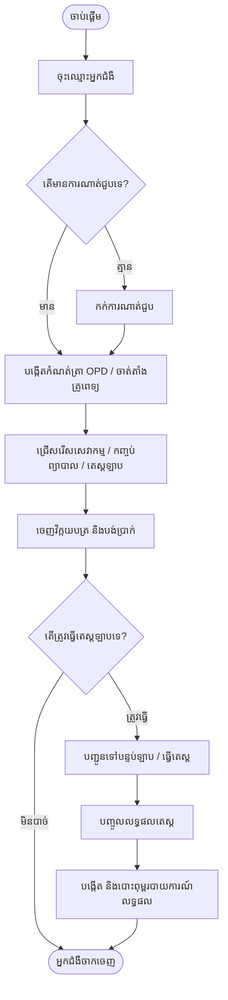
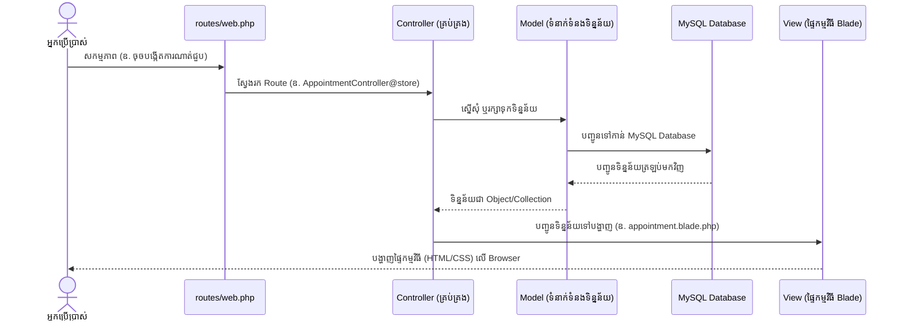
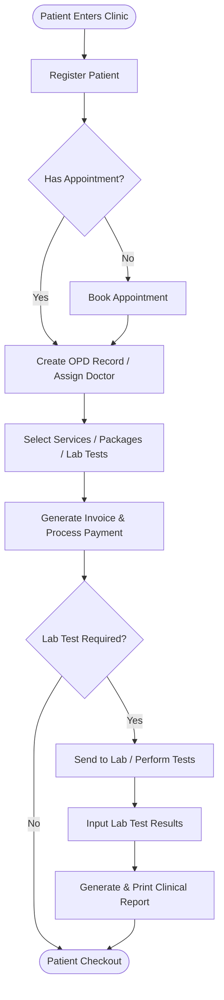

# Clinic Management System - Setup & Working Flow

> [!NOTE]
> ភាសាខ្មែរនៅខាងលើ / English version below.

---

## 🇰🇭 ភាសាខ្មែរ (Khmer Version)

ប្រព័ន្ធគ្រប់គ្រងគ្លីនិក (**Clinic Management System**) គឺជាកម្មវិធីគេហទំព័រដែលបង្កើតឡើងដោយប្រើប្រាស់ **Laravel (PHP)** និង **MySQL**។ វាត្រូវបានរចនាឡើងដើម្បីជួយសម្រួលដល់កិច្ចការប្រចាំថ្ងៃរបស់គ្លីនិក ឬមន្ទីរពេទ្យ ដូចជាការគ្រប់គ្រងព័ត៌មានអ្នកជំងឺ ការណាត់ជួបគ្រូពេទ្យ ការចេញវិក្កយបត្រសេវាកម្ម ការធ្វើតេស្តមន្ទីរពិសោធន៍ និងការចេញរបាយការណ៍ពិនិត្យជំងឺ។

---

### 🚀 របៀបដំឡើង និងបើកដំណើរការកម្មវិធី

អ្នកអាចជ្រើសរើសវិធីសាស្ត្រមួយក្នុងចំណោមវិធីពីរខាងក្រោម៖

#### វិធីសាស្ត្រទី ១៖ ការរៀបចំដោយស្វ័យប្រវត្ត (សម្រាប់តែ Windows)
គម្រោងនេះមានកម្មវិធីដំណើរការស្វ័យប្រវត្តស្រាប់៖
1. បើកដំណើរការ MySQL Server របស់អ្នក (ឧទាហរណ៍៖ XAMPP ឬ WAMP)។
2. ចុច Double-click លើឯកសារ [run.bat](file:///Users/apple/.gemini/antigravity-ide/scratch/clinic/run.bat) នៅក្នុងថត Root នៃគម្រោង។
3. កម្មវិធីនឹងដំណើរការ [setup_helper.php](file:///Users/apple/.gemini/antigravity-ide/scratch/clinic/setup_helper.php) ដើម្បីបង្កើតឯកសារ `.env` បង្កើត Database បញ្ចូលទិន្នន័យគំរូ និងបើក Server ឱ្យអ្នកដោយស្វ័យប្រវត្តនៅអាសយដ្ឋាន [http://127.0.0.1:8000](http://127.0.0.1:8000)។

---

#### វិធីសាស្ត្រទី ២៖ ការរៀបចំដោយដៃ (Manual Setup - macOS / Linux / Windows)
សូមអនុវត្តតាមជំហានខាងក្រោមនៅក្នុង Terminal ឬ Command Prompt៖

1. **ដំឡើងបណ្ណាល័យជំនួយ (Dependencies)**៖
   វាយពាក្យបញ្ជាខាងក្រោមដើម្បីទាញយកបណ្ណាល័យរបស់ PHP នៅក្នុងគម្រោង៖
   ```bash
   composer install
   ```

2. **កំណត់រចនាសម្ព័ន្ធបណ្ដោះអាសន្ន (.env)**៖
   ចម្លងឯកសារកំណត់គំរូទៅជាឯកសារកំណត់ផ្លូវការ៖
   ```bash
   cp .env.example .env
   ```
   បើកឯកសារ [`.env`](file:///Users/apple/.gemini/antigravity-ide/scratch/clinic/.env) រួចកែសម្រួលព័ត៌មានទាក់ទងនឹង Database (ដូចជា `DB_HOST`, `DB_PORT`, `DB_DATABASE`, `DB_USERNAME`, `DB_PASSWORD`) ឱ្យត្រូវទៅនឹង MySQL Server របស់អ្នក។

3. **បង្កើត Security Key**៖
   ```bash
   php artisan key:generate
   ```

4. **បង្កើត Database**៖
   ចូលទៅកាន់ phpMyAdmin រួចបង្កើត Database ថ្មីមួយដែលមានឈ្មោះថា `clinic_db` (ឬឈ្មោះផ្សេងដែលអ្នកបានកំណត់ក្នុង `.env`)។

5. **បញ្ចូលតារាង និងទិន្នន័យគំរូ (Migration & Seeding)**៖
   រត់ពាក្យបញ្ជាដើម្បីបង្កើតតារាង និងទិន្នន័យគណនី Admin ដំបូង៖
   ```bash
   php artisan migrate --seed
   ```

6. **បើកដំណើរការ Server**៖
   ```bash
   php artisan serve
   ```
   បន្ទាប់មក ចូលទៅកាន់ browser ហើយវាយអាសយដ្ឋាន៖ [http://127.0.0.1:8000](http://127.0.0.1:8000)។

---

### 🔑 គណនីសម្រាប់ចូលប្រើប្រាស់ (Admin Login)

គណនីសម្រាប់សាកល្បងដំបូងមានស្រាប់ពីការ Seed ទិន្នន័យក្នុង [UsersSeeder.php](file:///Users/apple/.gemini/antigravity-ide/scratch/clinic/database/seeds/UsersSeeder.php)៖
* **អ៊ីមែល (Email)៖** `admin@admin.com`
* **លេខសម្ងាត់ (Password)៖** `admin`

---

### 🔄 លំហូរការងាររបស់គម្រោង (Project Working Flow)

#### ១. លំហូរការងាររបស់អ្នកជំងឺ (Patient Journey)
1. **ចុះឈ្មោះ (Patient Registration)**៖ ចុះឈ្មោះព័ត៌មានអ្នកជំងឺថ្មីតាមរយៈ [PatientController.php](file:///Users/apple/.gemini/antigravity-ide/scratch/clinic/app/Http/Controllers/PatientController.php)។
2. **ណាត់ជួប (Appointment)**៖ បង្កើតការណាត់ជួបជាមួយគ្រូពេទ្យតាមរយៈ [AppointmentController.php](file:///Users/apple/.gemini/antigravity-ide/scratch/clinic/app/Http/Controllers/AppointmentController.php)។
3. **ការពិគ្រោះជំងឺក្រៅ (OPD Registration)**៖ បញ្ជូនអ្នកជំងឺទៅកាន់ផ្នែកពិគ្រោះជំងឺក្រៅ (OPD) តាមរយៈ [OpdController.php](file:///Users/apple/.gemini/antigravity-ide/scratch/clinic/app/Http/Controllers/OpdController.php)។
4. **គិតលុយ (Invoicing & Billing)**៖ ជ្រើសរើសសេវាកម្ម (Services) ឬកញ្ចប់ព្យាបាល (Packages) និងចេញវិក្កយបត្របង់ប្រាក់តាមរយៈ [InvoiceController.php](file:///Users/apple/.gemini/antigravity-ide/scratch/clinic/app/Http/Controllers/InvoiceController.php)។
5. **ការធ្វើតេស្តមន្ទីរពិសោធន៍ (Lab Test & Results)**៖ បញ្ចូលលទ្ធផលតេស្តមន្ទីរពិសោធន៍តាមរយៈ [ResultController.php](file:///Users/apple/.gemini/antigravity-ide/scratch/clinic/app/Http/Controllers/ResultController.php)។
6. **ចេញរបាយការណ៍ (Reporting)**៖ បង្កើត និងបោះពុម្ពរបាយការណ៍លទ្ធផលពិនិត្យជូនអ្នកជំងឺតាមរយៈ [ReportController.php](file:///Users/apple/.gemini/antigravity-ide/scratch/clinic/app/Http/Controllers/ReportController.php)។



#### ២. លំហូរការងាររបស់កូដ (MVC Flow)
នៅពេលអ្នកប្រើប្រាស់ធ្វើសកម្មភាពនៅលើគេហទំព័រ កម្មវិធី Laravel ដំណើរការដូចខាងក្រោម៖



---

## 🇬🇧 English Version

---

### 🚀 How to Run the Project

You can run this project using either the automated launcher script (for Windows) or standard manual steps (cross-platform for macOS/Linux).

#### Method 1: Automated Setup (Windows only)
1. Make sure your local **MySQL** database server (e.g., via XAMPP/WAMP) is running on your machine.
2. Double-click `run.bat` in the project root directory.
3. The script will automatically trigger setup operations using the local database parameters.

#### Method 2: Manual Setup (macOS / Linux / Windows)
1. **Install Dependencies**:
   ```bash
   composer install
   ```
2. **Environment Configuration**:
   ```bash
   cp .env.example .env
   ```
   Configure your connection credentials inside [`.env`](file:///Users/apple/.gemini/antigravity-ide/scratch/clinic/.env).
3. **Generate Application Key**:
   ```bash
   php artisan key:generate
   ```
4. **Database Setup & Seeding**:
   Create a new MySQL database named `clinic_db` and migrate/seed data:
   ```bash
   php artisan migrate --seed
   ```
5. **Start the Server**:
   ```bash
   php artisan serve
   ```
   Access the app at: [http://127.0.0.1:8000](http://127.0.0.1:8000)

---

### 🔑 Default Credentials
- **Email:** `admin@admin.com`
- **Password:** `admin`

---

### 🔄 Project Working Flow



---

### 📁 Key Directories & Modules

- **[routes/web.php](file:///Users/apple/.gemini/antigravity-ide/scratch/clinic/routes/web.php)**: Declares all application routes grouped under `auth` middleware.
- **[app/Http/Controllers/](file:///Users/apple/.gemini/antigravity-ide/scratch/clinic/app/Http/Controllers/)**: Contains core application controllers:
  - `PatientController.php`: Registers and lists patients.
  - `DoctorController.php` / `OpdController.php`: Configures doctor schedules and outpatient departments.
  - `AppointmentController.php`: Books and schedules patient visits.
  - `InvoiceController.php`: Generates invoices for services, OPDs, and package sales.
  - `TestController.php` & `ResultController.php`: Manages lab test inventory, maps references, and records individual test results.
  - `ReportController.php`: Orchestrates compilation and printing of haematology, biochemistry, immunology, and microbiology reports.
- **[app/Models/](file:///Users/apple/.gemini/antigravity-ide/scratch/clinic/app/Models/)**: Defines the database models (e.g., `Patient`, `Doctor`, `Invoice`, `Service`, `Test`, `Report`, `Result`) and their relational mappings.
- **[database/](file:///Users/apple/.gemini/antigravity-ide/scratch/clinic/database/)**:
  - `migrations/`: Defines DB schemas.
  - `seeds/`: Seeds initial application data.
- **[resources/views/](file:///Users/apple/.gemini/antigravity-ide/scratch/clinic/resources/views/)**: Blade templates rendering UI views.
